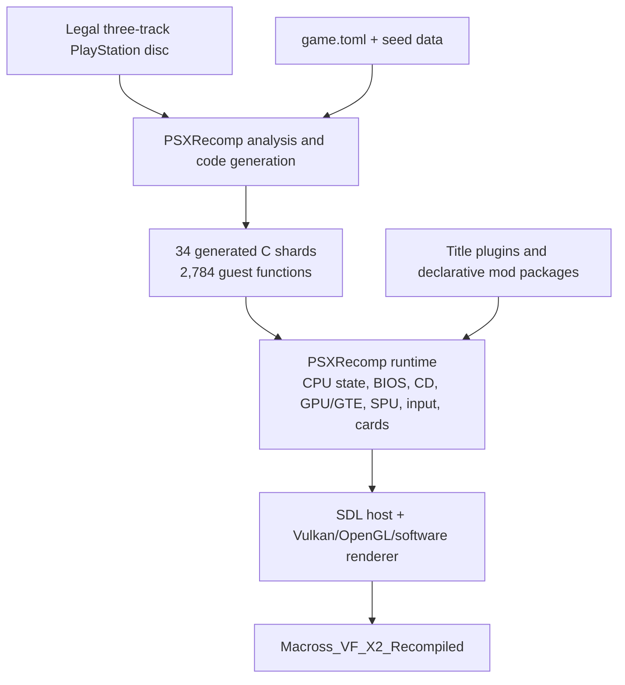

# Game architecture

## Scope

Macross VF-X2 is not being rewritten as a conventional source port. The
original PlayStation executable is analyzed and translated into C while
retaining guest addresses, registers, memory behavior, and calls into emulated
PlayStation services. PSXRecomp supplies the host runtime around that generated
guest program.

The primary project configuration is [game.toml](../game.toml). Build and
setup integration live in [CMakeLists.txt](../CMakeLists.txt) and
[codegen_setup.c](../codegen_setup.c). Title-owned runtime plugins live in
[src/macross_mods.c](../src/macross_mods.c).

## Layer model

Generated code is guest code expressed in C, not hand-maintained game logic.
It still performs cycle-aware guest loads and stores and uses PlayStation
addresses. Framework runtime code implements the surrounding machine and host
integration.

## Executable and memory layout

| Property | Value | Confidence |
|---|---:|---|
| Game ID | `SLPS-02237` | Confirmed |
| Executable | `SLPS_022.37` | Confirmed |
| PS-X EXE load address | `0x80011000` | Confirmed |
| Entry PC | `0x80011000` | Confirmed |
| Text size | `0x73800` | Confirmed |
| Initial stack base | `0x801FFFF0` | Confirmed |
| Generated functions | 2,784 | Confirmed by generation |
| Generated C shards | 34 | Confirmed by generation |

The first generated symbol is `func_80011000`. The current analyzer assigns
synthetic address-based names to most functions, so the symbol should be read
as an entry address, not a semantic description.

Generated declarations also contain alias bodies for overlapping or shared
guest regions. These aliases are normal static-recompilation artifacts and
must not be treated as duplicate source-level game systems.

## Build and generation flow

1. The contributor supplies the exact legal three-track CUE/BIN dump.
2. PSXRecomp verifies the data track and prepares local files under `disc/`.
3. The executable is analyzed using [game.toml](../game.toml) and the seed
   files under `seeds/`.
4. PSXRecomp emits the dispatch unit and 34 generated C shards under
   `generated/`.
5. CMake compiles generated guest code, PSXRecomp runtime code, and
   [src/macross_mods.c](../src/macross_mods.c).
6. Preloaded framework and title packages are staged under the runtime's
   bundled mod catalog.
7. The result is `Macross_VF_X2_Recompiled`.

The setup host uses [codegen_setup.c](../codegen_setup.c) to point the
first-run wizard at the PSXRecomp CLI, [game.toml](../game.toml), the generated
dispatch marker, the build directory, and the `psx-runtime` target.

## Boot and top-level flow

[game.toml](../game.toml) selects a BIOS-backed boot:

- BIOS HLE is disabled.
- OpenBIOS is bundled and enabled.
- The configured executable entry is `0x80011000`.

Runtime qualification currently establishes this path:

1. BIOS startup
2. Boot FMVs
3. Title and menus
4. Mission briefing
5. Variable Fighter selection
6. Mission loading
7. First 3D mission entry

This is not yet a full-game state map.

A large initialization routine at guest address `0x8001A154` calls multiple
subsystem initializers and requests a 320x240 display through a call at
`0x8005A494`. It is a useful startup landmark, but its complete role and the
full BIOS-to-game call chain are not yet semantically mapped.

## Disc and file loading

The original media contains one Mode 2/2352 data track and two CD audio tracks.
The executable uses the PlayStation BIOS file interface. The generated symbol
inventory includes wrappers for:

| Guest address | BIOS operation |
|---:|---|
| `0x800746A4` | File seek |
| `0x800746B4` | File read |
| `0x800746C4` | File close |
| `0x80074994` | First directory match |
| `0x800746D4` | Next directory match |
| `0x800746E4` | File delete |

The presence of directory enumeration and formatted CD paths indicates a
mixture of named-file loading and data-driven asset selection. A complete map
from missions to ISO files has not yet been built.

Fast Loading does not replace this game-side path. The title plugin requests
4x host pacing only while PSXRecomp's sustained non-XA loading detector is
active. Guest-visible callbacks, interrupts, VBlanks, XA, FMV cadence, and CD
deadlines remain in the emulated path.

## Rendering

### Original game path

The executable contains many GTE-tagged functions. Confirmed examples include
guest addresses:

- `0x80017C7C`
- `0x80017CFC`
- `0x8001D90C`
- `0x8001E5D0`
- `0x8002180C`

The game initializes a 320x240 display. Geometry and draw commands remain
guest-generated and flow through PSXRecomp's GTE/GPU implementation.

### Host presentation

[game.toml](../game.toml) requests Vulkan by default, with framework-provided
fallback renderers. The default internal resolution is 4x. PGXP hooks preserve
additional vertex precision and perspective-correct texture information while
leaving CPU propagation and precise culling disabled for compatibility.

The experimental widescreen package selects a native 16:9 surface rather than
stretching 4:3 output. It exposes additional horizontal 3D view and anchors
the HUD, but finite planet/city backdrop geometry leaves visible voids. That
feature therefore remains off by default.

## Audio

The validated path uses PSX CD/XA and SPU services:

- Boot and mission-transition XA playback works.
- First-mission audio remained stable under title-specific 4x loading.
- The title has one `.XA` file in the data track and two CD audio tracks.

There is no title-specific host audio replacement in `src/`. Generated guest
code continues to drive the shared runtime's CD and SPU implementations.

The following are not yet mapped:

- XA file and sector selection by state
- SPU voice/channel allocation
- Sound-effect and music bank formats
- Whether every campaign transition remains safe under accelerated loading

## Input

[game.toml](../game.toml) chooses digital pad mode by default. Controller
polling remains in generated guest code and the PSX runtime. The retail menu
reads the processed active-high input word at `0x80084294`; its known masks
include `0x1000`/`0x4000` for vertical movement, `0x2000`/`0x8000` for
horizontal editing, and `0x0800` for exit. Analog-specific behavior outside
the menu has not been identified.

## Saves and memory cards

The host profile stores memory cards under `saves/`. The executable includes
BIOS memory-card entry points for initialization, card read/write, new-card
handling, and status queries, including guest addresses:

- `0x80072874`: initialize card
- `0x80074A74`: card write
- `0x80074E24`: card read
- `0x80074A84`: new-card handling
- `0x80074E34`: card status

The save filename, slot structure, block allocation, checksum, and campaign
progress schema remain unknown.

## Mod boundaries

There are two distinct modification layers.

### Declarative packages

Packages can supply guarded disc overlays and framework or title defaults.
The English localization is entirely declarative at runtime: its generated
manifest maps verified replacement bytes to exact logical disc ranges.

### Activation plugins

[src/macross_mods.c](../src/macross_mods.c) registers title-owned callbacks:

- `macross.fast-loading` calls `psx_mod_set_load_acceleration(4, 0)`.
- `macross.widescreen.16-9` calls
  `psx_mod_set_fixed_display_aspect(16, 9)`.
- `macross.debug-menu` watches F12 and redirects the next safe
  `0x8001A7D8` function entry into the retained menu runner at `0x80025468`.
  A second entry hook installs a package-owned guest return address, then
  resumes the original function with its argument registers restored after
  the menu exits. This keeps the normal frame scheduler and input sampling
  active; a nested host-to-guest call would block both until the menu returned.
  Save states and Rewind are blocked only for the lifetime of that redirect.

Generated code also exposes framework hook boundaries for instruction and
memory-address modification, function-entry hooks, function replacement,
persisted options, and GPU/widescreen behavior. The debug-menu return address
is a package-gated guest function; no retail function body is patched or
permanently replaced.

## Architectural unknowns

1. Semantic names and responsibilities for most guest functions
2. The complete top-level state machine and mission-state enumeration
3. Mission-to-asset and module-loading tables
4. Audio bank, XA selection, and SPU voice management
5. Game-specific controller structures outside the mapped debug-menu input
6. Memory-card save format
7. Full-campaign compatibility
8. A title-specific fix for native-wide backdrop coverage

See [Cut and disabled content](cut-and-disabled-content.md) for retained debug
facilities that may help map several of these systems.
