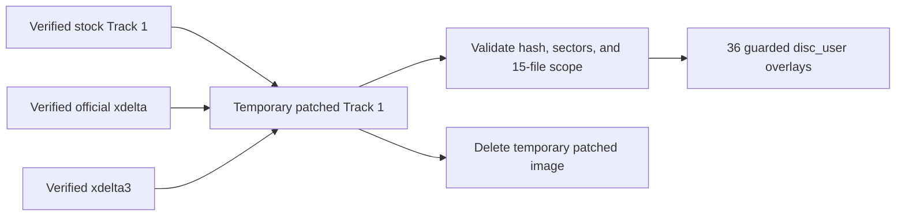

# Localization architecture and options

## Direct answer: images or strings?

For the content translated by NXP1000's patch, the answer is **images**.

The verified patch changes exactly fifteen `.TIX` image resources. It does not
change:

- `SLPS_022.37`
- any standalone `.TIM`
- any conventional text or string-table file
- any separately identified font resource
- ISO directory metadata

The localized mission briefings and Variable Fighter descriptions are
therefore pre-rendered raster graphics, image tiles, or a mixture of image
records inside TIX containers. They are not ordinary Japanese strings that
can be replaced with longer English strings in place.

This conclusion applies to the screens translated by the current patch. The
game still has runtime-rendered ASCII text for menus, status messages, and
retained debug facilities. A Japanese text renderer may also exist elsewhere,
but it is not how the current briefing translation is implemented.

## What is confirmed

| Observation | Result |
|---|---|
| Changed ISO files | 15, all `.TIX` |
| Changed sectors | 310 Mode 2 Form 1 sectors |
| Changed user bytes | 221,336 |
| Executable changed | No |
| Standalone TIM files changed | No |
| Conventional string table changed | None identified |
| Generated overlays | 36 guarded ranges, 634,880 bytes |
| Runtime result | English briefing graphics visibly render |

See [Disc and file formats](file-formats.md#english-patch-footprint) for the
full file list.

## Current workflow

[tools/prepare_english_localization.py](../tools/prepare_english_localization.py)
implements a lawful local conversion:



The generated package is ignored and local. Its manifest defaults the English
feature on for fresh profiles. Each overlay includes a hash of the expected
stock range so it cannot silently apply to the wrong disc bytes.

The complexity is not required by the game's runtime. It exists because:

1. the upstream release is an xdelta against the full raw track;
2. the upstream project does not declare permission to redistribute its patch
   or translated pixels; and
3. the project wants exact source-disc and overlay verification.

Once generated, the package is cached and ordinary builds do not repeatedly
decode the patch.

## Could localization be simpler?

Yes for local development, but not as a drop-in public replacement without
resolving asset rights.

### Option 1: keep the current generated overlay cache

**Feasibility: highest. Recommended for players.**

The current first-run import is complicated internally, but subsequent builds
already use the generated package directly. This preserves exact upstream
output without needing to understand TIX.

Benefits:

- proven runtime behavior;
- exact source and output hashes;
- no TIX decoder required;
- no patched disc retained;
- no translated data committed.

Cost:

- first preparation needs xdelta3 and the official patch.

### Option 2: accept a local directory of patched TIX files

**Feasibility: high. Recommended optional developer workflow.**

A future importer could accept a path such as:

```text
MACROSS_ENGLISH_TIX_DIR/
|-- DATA00/BRF/IMGMSN01.TIX
|-- ...
`-- SYSTEM/ADJUST.TIX
```

It would:

1. verify all fifteen stock ISO extents;
2. verify the supplied replacement files and their unchanged sizes;
3. split them into affected logical sectors;
4. generate the same guarded `disc_user` overlays.

This removes xdelta and temporary full-disc decoding from the developer
workflow. It does **not** make the translated files redistributable; users
would still need to obtain or create them lawfully.

### Option 3: extract patched TIX once, then use file-level local inputs

**Feasibility: high. Best bridge from the current patch.**

The current importer could optionally retain only the fifteen patched TIX
files in a private cache after the verified first import. Later regeneration
would operate on those file-level inputs rather than rerunning xdelta.

Advantages:

- smaller and semantically clearer cache;
- no repeated 430 MB temporary output;
- easy per-file comparison and tooling.

Risks:

- the cache contains translated derivative assets and must remain ignored;
- cache invalidation must include the patch hash, source-disc hash, and
  importer version;
- the current package cache already avoids most repeated work, so the user
  benefit is modest.

### Option 4: build a TIX decoder and image repacker

**Feasibility: medium. Best for new translations.**

A TIX tool could expose the image records as PNG plus metadata:

```text
TIX -> metadata.json + indexed PNG/CLUT
translated PNG + metadata.json -> byte-identical-size TIX
```

This would let translators edit images directly and would remove dependence
on NXP1000's xdelta for newly authored translations.

Required milestones:

1. decode record boundaries and dimensions;
2. identify 4-bit/8-bit pixel layout and CLUT data;
3. prove a decode/re-encode round trip with no changed bytes;
4. identify the exact image regions containing text;
5. enforce original extents, alignment, and VRAM constraints;
6. test every changed screen in runtime.

This is the most useful long-term localization tool, but it is not yet the
simplest implementation task.

### Option 5: patch runtime strings and fonts

**Feasibility: low for the currently translated screens.**

A string-based system would need to locate:

- validated Shift-JIS strings and pointer tables;
- the renderer that consumes them;
- glyph atlases and width tables;
- line breaking and screen-layout constraints;
- VRAM upload and palette behavior.

It would then need executable hooks or data overlays for longer English text.
Because the existing patch changes none of those components, this is unlikely
to simplify briefing/description translation.

It may still be appropriate for untranslated runtime text, HUD labels, or
menus after those paths are identified.

## Raw string-search limitations

The executable contains many high-bit byte pairs that superficially satisfy
Shift-JIS lead/trail rules. Machine code, pointers, and binary tables produce
the same patterns. A useful string inventory requires all of:

1. valid decoding over a meaningful run;
2. references from data or guest code;
3. observation that the reference reaches a text renderer;
4. identification of the corresponding font/glyph path.

Until then, a raw Shift-JIS hit is a lead, not a translatable string.

The executable does contain coherent ASCII debug and diagnostic strings. Those
prove that at least one runtime text path exists, but do not show that mission
briefing prose uses it.

## Recommended next implementation

The smallest useful research tool would be a **read-only TIX inspector**, not
an encoder:

1. enumerate header words for all 121 files;
2. cluster files by header pattern;
3. detect plausible embedded TIM records and CLUTs;
4. render candidate indexed surfaces;
5. compare stock and locally patched TIX resources;
6. emit no copyrighted pixels unless explicitly requested into a local,
   ignored output directory.

If that succeeds, add an optional local-TIX importer before attempting a full
authoring pipeline.

## Legal boundary

The NXP1000 repository publishes an official patch but currently declares no
redistribution license. This project therefore does not commit:

- the xdelta;
- patched TIX resources;
- decoded translated PNGs;
- generated overlay payloads.

Any future simpler workflow must preserve that boundary unless the rights
holders or patch authors provide suitable permission.
